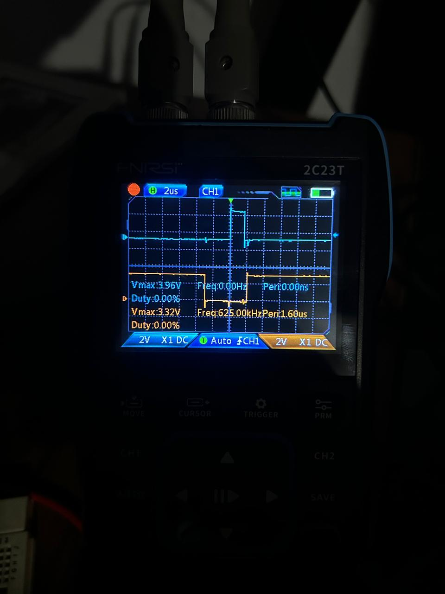
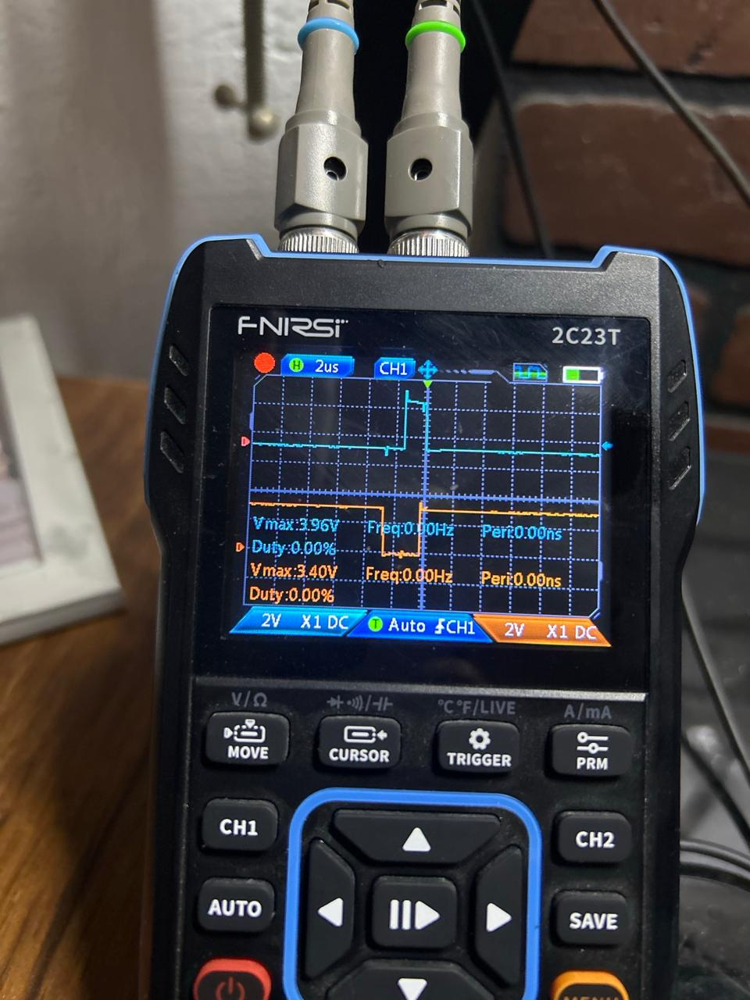

# Peripheral Configuration

Clock tree: see [README](../README.md#clock-configuration).

## PWM (TIM1)

| Parameter | Value | Notes |
|---|---|---|
| Channels | CH1–CH3 | Phase outputs |
| Counter mode | Center-aligned | PWM mode 1 |
| ARR | 1875 | |
| PWM frequency | 20 kHz | 2 × ARR / 75 MHz = 50 µs |
| RCR | 1 | |
| D_max | 0.90 | CCR max ≈ 1687 |
| Dead time | None in MCU | The STSPIN830 has no integrated dead time |

## Power stage (STSPIN830)

| Parameter | Value |
|---|---|
| tINd(ON) | 450 ns |
| tINd(OFF) | 250 ns |
| Motor | GBM2804H-100T |

## ADC

| Group | Type | Trigger | Channels | Status |
|---|---|---|---|---|
| Phase currents | Injected | TIM1 OC4 (CCR4 = 1800) | 3 (Ia, Ib, Ic) | Working |
| Speed reference | **TBD** | **TBD** | 1 | Not sampled currently |

| Parameter | Value |
|---|---|
| ADC clock | HCLK / 2 = 37.5 MHz (CKMODE=10) |
| Trigger latency | 60 ns (MCU datasheet value)
| Resolution | 12 bits |
| Sampling time | 6.5 cycles |
| Sequence length | ≈ 1.58 µs (3 channels) |

## ADC trigger timing

Current samples must fall inside the low-side window, when the shunt
carries phase current.

| Quantity | Value |
|---|---|
| Low-side window at D_max | 2 × (1875 − 1687) = 376 counts ≈ 5 µs |
| Trigger (CCR4 = 1800) | ≈ 1.5 µs after the CCR1 edge |
| Margin after the sequence | ≈ 2.7 µs before the window closes |

### Rationale:

- **First attempt (D = 95%, CCR4 = 1783):** the low-side window was only
  2.5 µs, and the trigger fired 2 counts after the CCR1 edge, during the
  switching transient, before the driver's 450 ns turn-on delay had elapsed
  .
- **Final (D_max = 90%, CCR4 = 1800):** the window doubles to about 5 µs, and
  the trigger places all three sampling instants near the center of the
  window, at least 1.7 µs after the CCR1 edge
  .

## Interrupts (NVIC)

| Source | Priority | Handler |
|---|---|---|
| ADC end of injected sequence | 0 | `adc_irq.c` |
| TIM1 | 0 | `gpt_irq.c` |

## Sensors

| Sensor | Interface | Status |
|---|---|---|
| AS5600 encoder | I2C | In progress |

## Validation

| Test | Method | Result |
|---|---|---|
| PLL frequency | MCO output on PA8, oscilloscope | Done |
| PWM low pulse width | Scope (FNIRSI 2C23T) | ≈ 2.6 µs at 90% duty|
| ADC trigger position | Scope + interrupt LED | Done|
